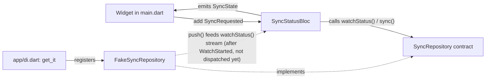

# FieldSync

[](https://github.com/Saeidomrani74/fieldsync/actions/workflows/ci.yml)

## Overview

FieldSync is a Flutter app being built as an offline-first team app for field work. Development began on 21 October 2026.

## Features

- Sync status UI with Idle, Syncing, Offline, and Failed states.
- Sync requests are handled through `SyncStatusBloc`.
- Dependency injection through `get_it`.
- A fake sync repository used while the backend and persistence architecture are being decided.

## Architecture

The app uses Bloc for explicit sync events and state transitions. `main.dart` creates the `SyncStatusBloc` with a `SyncRepository` obtained from the application dependency-injection setup. `app/di.dart` currently registers `FakeSyncRepository` as the implementation of that contract.

The UI sends `SyncRequested` events to the Bloc and reads the resulting `SyncState` through `BlocSelector`. The repository contract exposes a status stream and a sync operation. `FakeSyncRepository` implements that contract and can publish `SyncStatus` values through its stream. `WatchStarted` is implemented by the Bloc, but the current main screen does not dispatch it, so status watching is not started there. `SyncRequested` uses `droppable()`: while one sync handler runs, the Bloc ignores additional requests, and dropping a second tap is safe because the running sync is already performing the work that tap requested.



See [ADR-001: State management](docs/adr/001-state-management.md).

## Stack

- Flutter and Dart
- Bloc and `flutter_bloc`
- `bloc_concurrency`
- `get_it`
- Equatable
- GitHub Actions for CI

## Setup

```powershell
flutter pub get
flutter run
```

## Status

| Feature | Status |
| --- | --- |
| Login + refresh | not started |
| Offline create/edit via outbox | not started |
| Delta sync + conflicts | not started |
| Sync status UI | implemented with a fake repository |
| Realtime | not started |

## Known limits

- The backend is undecided; ADR-002 is open.
- The current repository is a fake implementation and does not persist data or communicate with a backend.
- Login, refresh, offline outbox operations, delta synchronization, conflict handling, and realtime updates are not implemented.
- The app currently does not start the repository status watcher from `main.dart`.
- iOS has not been tested.

A v0.1.0 APK is available on the [Releases page](https://github.com/Saeidomrani74/fieldsync/releases).

## Testing

Run manually on a Poco F5 with Android 15. CI builds on a clean machine. Unit and widget tests run in CI. iOS is not tested.
